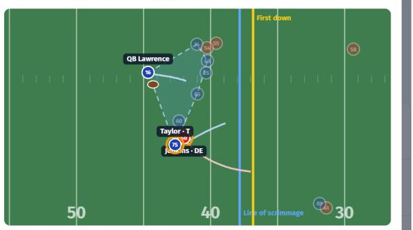

# Pass Protection Error Finder

**The insight:** coaches can't see every protection breakdown live. Using Next Gen Stats tracking + PFF charting + nflverse EPA, we flag every pass-protection error in Weeks 1-8 of 2021 (**8,085 flags across 122 games**) and link each one to an animated replay with the player ringed and the error moment marked on the timeline. Flags carry a confidence level: **Confirmed** (PFF sack/hit/hurry allowed, beaten, or penalty) or **Likely** (our tracking rule for a *free rusher* who got within 3 yds of the QB unblocked even though the offense had enough blockers). Each flag also carries the play's EPA, shared across the flags on that play. The skill-position finding: **running backs allow pressure on 11.3% of their pass-block reps (n=1,554), more than tight ends (8.6%), tackles (7.4%), guards (5.9%) or centres (4.2%)**, so the RB is the weakest link in pass protection per rep. A self-scout / opponent switch turns the same data into "fix this" or "attack this" lists, with recurring patterns ranked by frequency × cost and shown with sample sizes and 90% Wilson intervals.



## Run it

```bash
pip install -r requirements.txt
make data   # downloads nflverse 2021 play-by-play (cached in ext/) and runs backend/pipeline.py
make dev    # http://localhost:8000
make test   # unit tests: geometry, convex-hull pocket area, snap/throw resolver, engagement runs, Wilson bounds
```

The pipeline expects the competition data at `nfl-big-data-bowl-regional-event-data-main/data/` (or set `NFL_RAW`). Pre-built outputs are committed in `frontend/` (`data.json` + one replay JSON per flagged play), so `make dev` works without re-running the pipeline.

## How it works

- `backend/pipeline.py`: resolves the snap and end-of-dropback frames (manual events first, then auto events), normalizes direction so the offense always moves toward +x, and detects:
  - **Level 1**: PFF sack/hit/hurry allowed and beaten flags, plus penalties. The error frame is the engaged rusher's closest approach to the QB, or the frame he passes the blocker.
  - **Level 2**: free rusher. The error frame is when the rusher crosses the line of blockers. Chip, set-and-release and no-block assignments (CH/SR/NB) don't count as blockers.
- **Cost**: nflverse EPA, joined on `old_game_id`/`play_id`, from the charged team's perspective, split equally across a play's flags. It's labelled "play EPA (shared)" because it isn't the cost of the error itself.
- **Patterns**: grouped by player × error × down × distance band. The denominator is that player's pass-block reps in that situation. Patterns with fewer than 10 opportunities are hidden.
- All thresholds live in `config/thresholds.yaml`. Reports are in `reports/` (data check, Level 2 calibration).
- `frontend/index.html`: a static HTML Canvas app with the alerts list, patterns, RB/TE protection tab and play viewer (0.25/0.5/1x, scrubber, arrow keys, trails, pocket hull, flag rings, click-a-player inspect).

## Limitations

The play call is unknown, so an error may be the design rather than the player. The data covers pass plays only and tracking ends about 0.5 s after the throw. Eight weeks gives small samples. The free-rusher rule matches a PFF pressure on the same rusher only 16.7% of the time, which is why it's labelled "Likely: check the film" and not presented as fact.

*Built at the NFL Big Data Bowl London regional (UCL BaseKX, 9 Oct 2026). Data: NFL Next Gen Stats, PFF, nflverse.*
